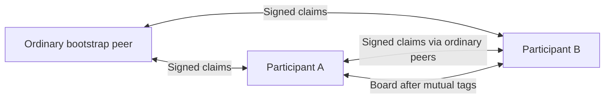

# Omachan protocol draft v1

The agent name, marks, paths, and signing domain are specific to Omachan. This network is separate from `%rumors`. It uses core Urbit services and the unmodified `%pals` agent; the desktop interface is just an authenticated client of the ship.

## Two channels



Discovery has no central registrar. A default distribution source is a convenient first contact. An explicitly joined ship can accept a direct, signed introduction from any non-dismissed ship with the agent installed, without first requiring friendship. Subsequent exchanges use established discovery links, tagged mutuals, or the configured bootstrap. By default received announcements do not modify Pals. The opt-in `autoAccept` preference accepts fresh, verified active claims while discovery is joined; dismissed ships are excluded.

Board traffic uses a separate Gall subscription path and a private handoff poke. Each endpoint reads its current Pals state before accepting a watch, emitting a live fact or snapshot, ingesting a received fact, or sending/accepting a private handoff. The required predicate is local mutual friendship plus the local `omarchy` tag. Since both endpoints enforce it, successful delivery requires both tags. Discovery consent and board membership are distinct: withdrawing discovery leaves existing tagged friendships intact.

## Signed announcements

`%omachan-hello` carries a direct claim. Its signed origin must equal the authenticated sending ship. `%omachan-claims` carries up to 16 `[claim distance]` entries from an established discovery peer.

The signed body contains:

| Field | Meaning |
| --- | --- |
| `%omachan-membership-v1` | Fixed protocol/signing domain |
| `origin` | Claiming ship |
| `era`, `life` | Breach era and key revision |
| `revision` | Persistent monotonic value, at least the current Urbit timestamp |
| `issued`, `expires` | Maximum seven-day validity; at most five minutes of future clock skew |
| `active` | Join or withdrawal |
| `relay-only` | Legacy signed slot, ignored; new claims set it false |
| `label` | Exactly `omarchy` |

The envelope includes the public key and a signature over the jammed body. Verification uses Urbit's existing crypto primitives. For non-comets the embedded key must match Jael's current ship/era/life record. For comets the public key fingerprint must match the comet identity, with era zero and life one. A signature alone, without this identity binding, is insufficient.

Unknown/newer keys are quarantined while Jael is asked for keys; they do not become suggestions or get forwarded. Pending entries expire after ten minutes. Current accepted signers are subscribed for key updates. Current-key checks are repeated when displaying and forwarding claims. Active local claims renew when less than one day remains, or when their key binding changes.

Ordering compares era, life, then revision. Old claims cannot overwrite a newer withdrawal. A withdrawal wins over an active claim at equal revision. Expired remote claims are pruned; they cannot be replayed as fresh. A reboot retains revisions and claims. A fresh installation starts with discovery off.

Claims travel up to two hops. The original body/signature survives forwarding. The hop count and observed `via` ship are routing metadata, not signed identity claims. Each client records its immediate authenticated source for the discovery UI. A peer can misreport distance; the limit describes cooperating implementations, not a cryptographic prohibition on further sharing.

## Peer exchange

Manual **Add** issues `%meet ship {omarchy}` to local Pals. Pals unions tags, preserving the existing friendship and other tags. Omachan sends a direct introduction to make the add-back flow possible. The other ship must add/tag the first in its own Pals, manually or through its own auto-accept preference.

Manual **Remove tag** issues `%part ship {omarchy}` and hides the suggestion locally. It does not remove the entire friendship. **Hide** prevents direct discovery and board exchange with that ship locally; a signed claim about it can still arrive through another peer and remain hidden. **Restore** clears this local dismissal and makes the peer eligible for auto-accept again.

The `bootstrap` action uses the desk-recommended hub when no `ship` override is supplied, and adds that first pal before publishing a signed local claim. A successful local Pals acknowledgment triggers joining and announcement. `preferences {autoAccept}` records the choice persistently. Auto-accept runs on accepted discovery traffic, preference changes, and 30-second maintenance, with at most 32 additions per pass. It rechecks freshness and current Jael identity binding, preserves unrelated tags, and does not require an open frontend.

Pals tag-only changes do not emit the same updates as relationship changes. Consequently authorization is checked on each message, while a 30-second maintenance cycle repairs or removes transport subscriptions. A displayed connection reflects the latest watch acknowledgment; a remote tag change may take until its cleanup cycle to change that status, but its send/receive checks already prevent traffic.

## Board

Peers watch `/board/v1/~subscriber` on `%omachan`. The path must match the authenticated requester. `%omachan-posts` facts contain batches of at most 16 entries:

```
[[id=@uv when=@da what=@t] distance=@ud]
```

The origin creates an ID from local entropy, time, and text. No ship identity or signature is attached. The author uses Suite's 50/50 choice: broadcast directly or privately poke a random eligible peer with `%omachan-pass`, carrying only `[id when what]`. Each newly receiving proxy makes the same choice. Private passes preserve the payload and do not spend the public hop budget. Proxy selection excludes the immediate sender, self, dismissed peers, and peers whose passes have failed. With no candidates, the post is broadcast directly. There is no mandatory initial handoff or artificial delay.

A private pass has a 30-second acknowledgment timeout. Negative acknowledgment or timeout marks that peer missed and repeats the coin flip; positive acknowledgment ends the sender's pending attempt. Successful incoming board traffic clears that peer's missed status. Attempt wires include the peer, post ID, and deadline so stale acknowledgments/timers cannot complete a replacement attempt. Maintenance retries when the selected peer loses eligibility. Failed peers can become eligible for selection again after successful board traffic.

The ship that chooses broadcast starts at distance zero; each ordinary gossip transmission increments distance. A distance-two post is retained but cannot be relayed again. Ordinary broadcast relays do not flip the coin. A post seen privately is visible locally but excluded from reconnect snapshots until this ship broadcasts it or receives a public copy. A received public copy adopts its public distance, then follows normal gossip rules. Reconnect snapshots preserve distance instead of replenishing the budget. This intentionally avoids Suite's catch-up behavior of re-originating cached posts.

Duplicate public IDs are ignored unless the identical payload arrives by a shorter public path; conflicting payloads with an existing ID are rejected. As in Suite, a duplicate private handoff is acknowledged without forwarding again. Consequently a private cycle can stop without anyone broadcasting. An acknowledgment means accepted, not proven publication; delivery is best effort. There is no retransmission after a successful private acknowledgment merely because a public copy has not returned.

Every delivery needs a permitted Pals edge. The bootstrap is an ordinary participant: its address only seeds discovery and grants no board access by itself. Once mutually tagged, it can receive, proxy, relay, and publish gossip under the same rules as everyone else. There is no discovery-only role or posting restriction. Old saved role flags are cleared on load, and the former `relayOnly` API option is ignored. The legacy bit remains in the signed envelope so existing signatures can still be verified.

Posts are at most 1,024 UTF-8 bytes and retained for 14 days, capped at the 500 most recently received. A local monotonic arrival sequence orders the feed, independently of the authored timestamp; duplicate delivery or a shorter path does not move a message. Arrival metadata never enters the gossip payload. Legacy cached posts are initially ordered by their previous authored timestamps, because their receipt order was not recorded. Future timestamps beyond five minutes are rejected. The UI renders text literally. Board posts are unsigned: relays are trusted to preserve them. Direct peers identify the immediate sender, which may be the author or a proxy. Public hop distance measures distance from broadcast release, not authorship. A 50/50 routing choice is not a 50% posterior probability that the sender is the author; topology and observations matter. There is no mixing, cover traffic, or protection against colluding peers.

## HTTP and client

Public static files are served under `/apps/omachan/` and `/omachan/`. `GET /omachan/state.json` requires authenticated local identity. `POST /omachan/action` also requires `Origin` to match the request Host and `x-omachan: 1`, with a maximum 8,192-byte JSON body. Remote Gall senders cannot assert authenticated local identity through the HTTP request mark. Diagnostic scries/pokes are local-only.

Actions: `join`, `leave`, `retry`, `config {seed}`, `bootstrap {ship}`, `preferences {autoAccept}`, `add/remove/dismiss/restore {ship}`, and `post {text}`. Both interfaces use this API; equivalent `%json` pokes are accepted only from the local ship. The web UI polls every four seconds while visible. The QML bar popup polls every five seconds while open, including the peer view so inbound requests appear promptly. Background polls do not set the action-busy flag. A user action arriving during a poll is queued, and keyed list models update changed rows in place so unchanged rows, focus, drafts, and scroll positions remain stable.

Before an app is available, the native helper reads Hood’s `/kiln/pikes` scry and uses temporary Eyre channels for `kiln-install`/`kiln-revive`, waiting for Gall acknowledgments and deleting the channels. It installs only the requested `%omachan` and its missing `%pals` dependency, preserving existing desk sources. The UI waits until the app responds before proceeding.

The native helper uses Python's standard HTTP/cookie libraries, rejects redirects, and keeps one account's cookie jar in memory. Remote URLs must use HTTPS; loopback HTTP is allowed for local development. The +code travels over helper stdin, never in argv, and the input is cleared on submission or closing the popup. Authentication failure clears the cookie jar. It never writes a login code or cookie to disk. No claim signature is computed in either frontend; signing happens on the user's ship.

## Capacity and remaining work

The draft caps the claim cache at 512 origins, discovery links at 256, tracked key identities at 512, and pending unknown claims at 128. These are defensive bounds, not a peer-selection policy. Users may manually or automatically form an all-to-all friendship graph within those limits. A large all-to-all graph would need sampling, backoff, paginated anti-entropy, and a clearer admission policy.

Discovery does not prove the claimed operating system, and the protocol does not resist Sybil attacks by itself. Hop budgets and retention cannot stop peers keeping or retransmitting copies. Key rotation logic uses current Jael state, but actual livenet rotations, breaches, and long partitions remain untested. State schema `%1` adds public-post membership, pending handoffs, and missed peers. Loading `%0` preserves the existing settings, discovery, and posts, treating all old posts as already public. Pending handoffs persist across reloads; overdue attempts are retried during startup maintenance.

State schema `%2` migrates `%0` and `%1`, preserves existing claims, posts, settings and exclusions, and adds auto-accept (default off), the recorded preference choice, a pending bootstrap, and local arrival ordering. Existing friendships are unchanged by migration.

The desk configures its default distributor and recommended hub in `lib/omachan-config.hoon`. The state API reports `distributor` (the actual remote desk source when available) separately from `hub` (the current first contact, otherwise the desk default). The native installer never substitutes its installation source for the hub. Fresh installs initialize discovery from the configured hub; upgrades preserve saved peer choices. Both normal settings views omit editable bootstrap controls. Local admin/development `config {seed}` remains supported. No Tlon group or other Gall dependency is added.
